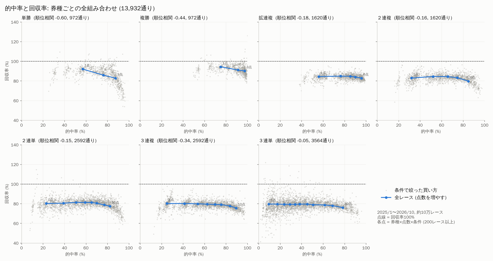
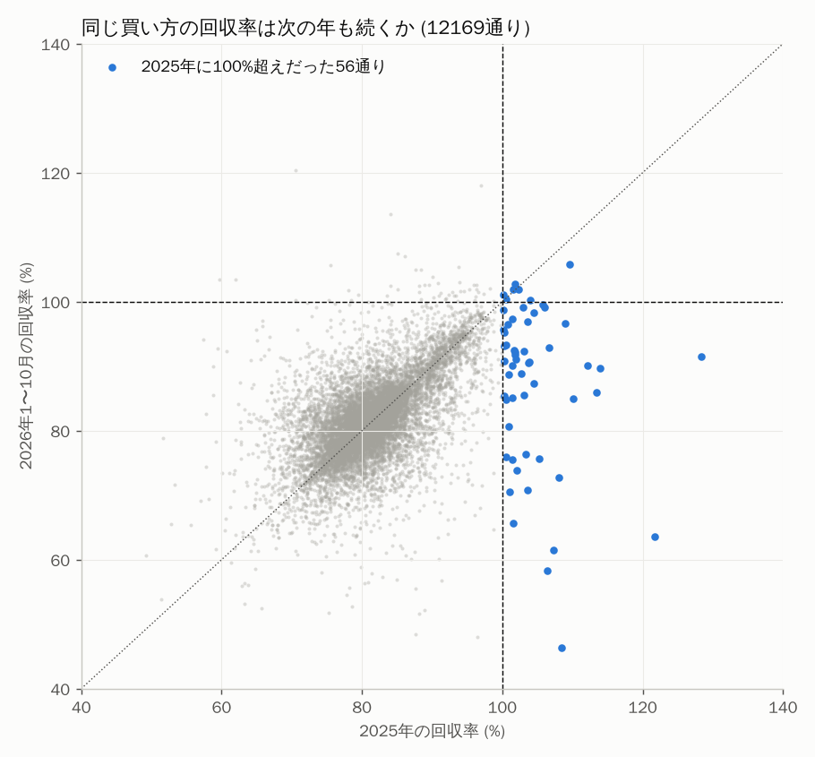

# レース予想と買い方の検証

## 結論

- **的中率と回収率の両方で一番よかったのは「本命の1着確率が80%以上のレースだけ、本命の複勝を1点買う」買い方**。的中率は約92%、回収率は97〜99%。
- ただし **回収率が100%を超える買い方は1つもなかった**。2026年の検証でも2017年の検証でも、どの買い方も長く続ければ少しずつ負ける。95%信頼区間の上限も100%未満。
- 単純に「的中率」だけを上げたいなら、買う点数を増やせばいくらでも上がる（3連単120点買いなら100%）。でも回収率は62%まで下がる。このため、的中率と回収率は必ずセットで見る。
- **2年続けて回収率100%を超えたのは、「予想勝率 × 予想オッズ」の期待値が1以上の艇の単勝を買う方法だけ**（2025年 102.9%、2026年 102.5%）。フォーメーションや選手ごとの買い方では、100%超えは次の期間に続かなかった。
- 13,932通りの組み合わせで調べると、**同じ券種の中では的中率と回収率は逆向きに動く**（点数を増やすほど的中率は上がり、回収率は下がる）。ある年に回収率100%を超えた買い方も、翌年には平均88%に戻った。両方の年で続いたのは「本命がB1級のときは単勝・複勝の回収率が高い（約98%、確率50〜70%の単勝は約100%）」という傾向だけ。
- 券種でみると、回収率は **単勝・複勝 (91〜99%) > 拡連複 (約85%) > 2連単・2連複・3連複・3連単 (78〜84%)** の順。単勝・複勝は控除率が小さく（払戻率80%、他の券種は75%）、さらに本命が過小評価されがち（いわゆる「本命・大穴バイアス」）なので、本命の単勝・複勝は払戻率より回収率が上になる。

## 検証の方法

- データ: `boatrace.sqlite`（番組表 B と競走成績 K）。2026年のDB（1/1〜10/23）と1997〜2017年のDBを使った。2018〜2025年はまだ取得中。
- **時系列で分けて検証**（未来のデータは学習に使わない）。
  - 検証A: 2026年2〜5月で学習、6月で調整、**2026年7/1〜10/23（17,964レース）** で評価
  - 検証B: 2014〜2016年10月で学習、2016年11〜12月で調整、**2017年（54,501レース）** で評価
- 1点100円として、実際の払戻金で回収率を計算。欠場・フライング・出遅れの艇を含む券は返還（100円戻る）として計算した。
- 回収率の 95% 区間はレース単位のブートストラップ（300回）。

## モデル

LightGBM で各艇の1着確率を出し、2・3着は Harville 型（1着を除いた残りの艇で確率を分け直す）で連単・連複の全組み合わせの確率にする。

| 版 | 特徴量・学習方法 |
|---|---|
| v1 | 枠番、場、級別、全国/当地の勝率・2連率、モーター・ボートの2連率、年齢・体重、今節成績、選手×枠番の過去の1着率、1号艇との勝率差 |
| v2 | v1 ＋ 外れの分析で足したもの: 選手の平均ST・STのばらつき・フライング率、前付け率、外枠からの1着率、イン艇と攻める艇（2〜4号艇）のST差、内側の艇とのST差、A1の人数 |
| v3 | v2 と同じ特徴量で、1着は「レース内 softmax」、2・3着は「Plackett-Luce（着順そのもの）」で学習する2つのモデルを組み合わせた |
| v4 | v3 ＋ 選手の重み（枠の有利不利を除いた強さを全期間・直近1年・直近90日で、選手×場の相性、直近1年の選手×枠の1着率）と並び（今日の5人の相手との過去の直接対決の勝率、内側・外側の艇の強さ）。日々の予想ツールはこれを使う |

「前日」は番組表だけ、「直前」はさらに展示タイム・風速・波高・風向も使う版。

### 予想の当たり具合（テスト期間）

| | 検証A 2026 前日 | 検証A 2026 直前 | 検証B 2017 前日 | 検証B 2017 直前 |
|---|---|---|---|---|
| 参考: 1号艇の1着率 | 54.5% | 54.5% | 51.4% | 51.4% |
| v1 本命が1着 | 56.6% | 56.9% | 55.1% | 55.4% |
| v3 本命が1着 | 56.5% | **57.0%** | 55.1% | **55.4%** |
| v1 3連単1点目が的中 | 8.9% | 8.8% | 8.5% | 8.8% |
| v3 3連単1点目が的中 | 9.1% | **9.5%** | 8.8% | **9.1%** |
| v1 予想2着が的中 | 28.1% | 28.4% | 28.1% | 28.3% |
| v3 予想2着が的中 | 29.0% | **29.5%** | 29.0% | **29.1%** |

1着の当たりは v1 からほぼ変わらない（1号艇が強すぎて、本命はほぼ1号艇になるため）。改善したのは2・3着の当て方で、3連単1点目の的中は 2026年で 8.9%→9.5%、2017年で 8.5%→9.1%。確率の正確さ（対数損失）もすべて改善した。予想した確率と実際の勝率もほぼ一致している（例: 本命80%以上 → 実際に1着 82%）。

## 選手の重み付けと並び（v4、全期間のDBで検証）

1997〜2026年の全データのDBで、2019年からの成績を選手の過去成績づくりに使い、2022年1月〜2026年5月で学習、**2026年7/1〜10/24（18,132レース）** で評価した（前日モデル）。

| | v3（2026年だけで学習） | v3（全データ） | v4 選手の重み＋並び | v4 ＋ 選手ID をそのまま使う |
|---|---|---|---|---|
| 本命が1着 | 56.5% | 56.8% | **57.0%** | 56.8% |
| 予想2着が的中 | 29.0% | 29.4% | **29.8%** | 29.6% |
| 予想3着が的中 | 23.0% | 23.3% | **23.7%** | 23.4% |
| 3連単1点目が的中 | 9.1% | 9.4% | **9.5%** | 9.4% |
| 1着確率の対数損失（小さいほど良い） | 1.202 | 1.183 | **1.181** | 1.190 |
| 本命の単勝 回収率 | 91.4% | 91.8% | 91.8% | 92.2% |
| 本命80%以上だけ複勝 的中率/回収率 | 91.8% / 97.3% | 93.1% / 98.1% | 92.8% / 98.0% | 92.8% / 98.1% |

- **一番効いたのは「選手×枠の過去の成績を長い期間で計算する」こと**（2026年だけ → 2019年から）。この特徴はもともと重要度の約7割を占めていて、選手の重み付けはすでにこの形で入っていた。
- v4 で追加した選手の重みと並びは、確率の正確さを統計的にはっきり改善した（1着の対数損失 −0.0019、95%区間 −0.0033〜−0.0006）。ただし改善は小さく、的中率は +0.1〜0.4 ポイント程度（偶然の範囲を出ない）。回収率はほぼ変わらない。
- 直接対決の成績は思ったほど効かなかった。今日の相手1人と過去に同じレースを走った回数は、2019年以降で中央値6回と少なく、数字が安定しないため。
- 選手番号をそのまま特徴にする（選手ごとに自由に重みを付ける）と、学習期間に合わせすぎて逆に悪くなった。

## 全組み合わせでの的中率と回収率の関係

2024年11月までで学習した v4 モデルで、**2025年1月〜2026年10月の約10万レース** を予想し、
「券種（7種）× 点数（1〜30点、43通り）× 条件」をすべて試した。条件は、本命の1着確率・本命の枠・本命の級別・場・レース種別・R番号・風速・波高（風と波は直前の情報）・本命のモーター順位・1号艇の級別の1つ、または「本命の確率」と他の条件の2つの組み合わせ。200レース以上ある **13,932通り** を集計した（全結果は `grid.csv`、`python analysis/grid.py` で再現できる）。



**的中率と回収率の相関**

- 全13,932通りをまとめると相関は弱い正（順位相関 +0.18）。ただしこれは「単勝・複勝は的中率も回収率も高い」という券種の違いによるもの。
- **同じ券種の中では負の相関**（単勝 −0.60、複勝 −0.44、3連複 −0.34、拡連複 −0.18、2連複 −0.16、2連単 −0.15、3連単 −0.05）。点数を増やすと的中率は上がるが、回収率は下がる（点数だけを変えたときの順位相関の中央値 −0.40）。
- 券種と点数を固定して条件だけを変えると、相関は正（中央値 +0.30）。本命が堅いレースに絞ると的中率と回収率が一緒に上がる。
- 全レースでの回収率は券種でほぼ決まる: 複勝1点 94%、単勝1点 92%、拡連複 83〜85%、2連複 80〜84%、2連単・3連単・3連複 76〜81%。3連単は1点でも30点でも 76〜80% でほとんど変わらない。

**回収率100%超えは続かない**



- 全期間で回収率100%を超えたのは 63通り（0.5%）。しかし、2025年に100%を超えた56通りは、2026年には平均 88% に戻った。2026年も100%を超えたのは 7通りだけ。
- 2025年に回収率が 95〜100% だった買い方のうち、2026年に100%を超えたのは 5%。これだけ多くの組み合わせを試せば、偶然100%を超えるものが出てくる。
- 的中率は年が変わってもほぼ同じになる（相関 1.00）。回収率は券種と点数の差としては続く（相関 0.57）が、条件で絞り込んだ効果だけを取り出すと相関は 0.24 しかない。

**唯一、両方の年で続いた傾向: 本命がB1級のとき**

| 本命の級別 | レース数 | 単勝の回収率（95%区間） | 複勝の回収率（95%区間） |
|---|---|---|---|
| A1 | 42,306 | 88.8%（88.0〜89.6） | 93.2%（92.6〜93.8） |
| A2 | 31,226 | 91.7%（90.6〜92.8） | 93.1%（92.3〜93.8） |
| B1 | 26,098 | **97.6%（96.1〜99.1）** | **97.7%（96.3〜99.2）** |
| B1 かつ本命の確率 50〜70% | 8,103 | **100.5%（98.4〜102.7）** | 98.4%（96.8〜100.1） |

モデルが「B1級でも勝つ」と見た選手（ほとんどが1号艇）は、買う人に過小評価されている。逆にA1級の本命は買われすぎていて回収率が低い。「B1級の本命・単勝」は、本命の確率が50〜60%のときに2025年 100.5%・2026年 100.4%、60〜70%のときに100.1%・101.1%と、両方の年で100%前後だった。ただし95%区間は100%をまたいでいて、利益が出ると言える根拠はない。とんとん（損益ゼロ前後）の買い方と考えるのが妥当。

## 選手ごとの勝率

2025年1月〜2026年10月の成績（30走以上の1,658人）は `racers.csv`。級別の中央値は、1着率が A1 27%・A2 20%・B1 10%・B2 2%、単勝の回収率が A1 75%・A2 71%・B1 63%・B2 27%。選手ごとの単勝回収率は期間が変わると続かない（前の章の「選手ごとの買い方」）ので、「この選手を買えば儲かる」という使い方より、予想勝率の材料（選手×枠の1着率など）として使うのがよい。

## 回収率100%超えを狙う: フォーメーション・選手別・期待値

### フォーメーション（効果なし）

予想の順位で作るフォーメーション 123通り（単勝・複勝の1〜3番手、2連単の1着固定流し・1/2着流し、3連単の「1着候補→2着候補→3着候補」67通り、2連複・拡連複の本命軸流し・BOX、3連複のBOX・1頭軸・2頭軸）を、前の章と同じ条件と掛け合わせて **36,039通り** 計算した（2025年＝発見、2026年＝確認、`python analysis/formation.py model ...`）。

- 2025年に回収率100%を超えた526通りは、2026年には平均75%に下がった（100%超えのままは53通り＝10%）。
- 両方の年で良かったのは、やはり「本命がB1級・確率50〜70%の単勝・複勝」（100〜101%）だけ。フォーメーションを工夫しても回収率は上がらない。

### 選手ごとの買い方（効果なし）

モデルを使わずに、選手全体・選手×枠・選手×場ごとに「単勝・複勝・2連単1着固定流し・2連単2着固定・3連単1着固定流し・3連単1・2着付け・3連複軸流し・拡連複軸流し」の8種類を計算した（2015〜2022年＝発見、2023〜2026年＝確認、`python analysis/formation.py racer ...`）。

| 選び方（発見期間に100回以上出走） | 選ばれた数 | 確認期間の回収率 |
|---|---|---|
| 選手×枠で単勝が100%超え | 1,118 | 86.7% |
| 選手×枠で複勝が100%超え | 928 | 91.3% |
| 選手×枠で3連単1着固定流しが100%超え | 470 | 68.8% |
| 選手で単勝が100%超え | 37 | 83.5% |
| 選手×場で単勝が100%超え | 599 | 74.7% |

「この選手（この枠）は儲かる」という傾向は、次の期間にはほとんど残らない。

### 単勝の期待値で買う（2年とも100%超え）

公式データには買う時点のオッズが無い。そこで「1着になった艇の単勝払戻＝その艇の最終オッズ」を使い、番組表の情報（級別・勝率・枠・モーターなど）から **買う人がつけるオッズを予想するモデル** を作った（2022〜2024年で学習）。
**期待値 ＝ 予想勝率 × 予想オッズ** が1以上の艇は、買う人に実力より低く見られている可能性が高い。この艇の単勝だけを買う（`python analysis/value.py ...`）。

| 期待値の下限 | 2025年 点数 | 2025年 回収率 | 2026年1〜10月 点数 | 2026年 回収率 | 合計の回収率（95%区間） |
|---|---|---|---|---|---|
| 0.9 | 43,689 | 99.0% | 36,833 | 97.1% | 98.2%（96.8〜99.4） |
| **1.0** | **14,537** | **102.9%** | **12,468** | **102.5%** | **102.7%（99.8〜105.8）** |
| 1.1 | 4,599 | 105.5% | 4,085 | 106.7% | 106.1%（100.0〜112.1） |
| 1.2 | 1,512 | 106.5% | 1,392 | 103.3% | 105.0%（96.2〜113.4） |

- 期待値1以上で、**2025年・2026年とも回収率約103%**。今回試した方法の中で、2年続けて100%を超えたのはこれだけ。1日あたり約41点、的中率は約32%。
- 22か月のうち15か月で100%超え。1点100円で買い続けた場合、2025年1月〜2026年10月の累計は約+7.4万円（約2.7万点、270万円分購入）、途中の最大の落ち込みは約2.9万円。
- 選ばれる艇の内訳: **B1級は回収率106%**（14,631点）、A1級は97%、A2級は99%。枠では **3号艇 110%・4号艇 105%**、6号艇は83%。予想勝率では **10〜30%の中穴が104〜107%**。
- 毎日のツールの `predict` に「単勝買い目」（期待値1以上の艇）が出る。`check` で実際の回収率がわかる。

**注意**

- 95%区間の下限は100%前後で、「確実に勝てる」とまでは言えない。月ごとの上下も大きい（85%〜115%）。
- 回収率は締切時点の最終オッズで計算している。買う時点のオッズは締切までに変わる。
- 実際のオッズ（公式サイトの直前オッズ）を取得して「予想勝率 × 実際のオッズ」で選べば、さらに精度が上がる見込み。これが次の改善候補。

## 外れたレースの原因（2026年7〜10月、v1 直前）

- 本命が1着を逃したレースの **82%は、まくり・まくり差し・差し**。つまり「1号艇（本命）がスタートで遅れて外から攻められた」負け方。
- 本命のスタートがレースで一番速かったときの的中は 73%、一番遅かったときは 33%。**スタートが結果を大きく左右する**のに、スタートはレース前には分からない。
- 風が強い・波が高いほど外れやすい（風2m以下 58% → 6m超 51%、波2cm以下 59% → 5cm超 52%）。
- 進入が枠なりでないレース（前付けあり）は 52%、枠なりは 58%。
- フライング・出遅れがあったレースは 34%。
- 場によって差がある（平和島 46%・戸田 48%・江戸川 50% が低め、下関 63%・常滑 63%・福岡 62% が高め）。

→ v2 では「選手の平均ST・STのばらつき・フライング率」「イン艇と攻める艇のST差」「前付け率」などを追加し、v3 では2・3着の情報も学習に使うようにした。ただしスタートそのものはレース前に分からないので、1着の的中率の上限は 55〜57% 程度にとどまる。

## 買い方ごとの的中率と回収率（v3 前日モデル）

| 買い方 | 点数 | 2026 的中率 | 2026 回収率 | 2017 的中率 | 2017 回収率 |
|---|---|---|---|---|---|
| **本命80%以上のレースだけ 本命の複勝** | 1 | **91.8%** | **97.3%** | **92.8%** | **98.9%** |
| 本命70%以上のレースだけ 本命の複勝 | 1 | 88.1% | 95.9% | 89.3% | 98.4% |
| 本命70%以上のレースだけ 本命の単勝 | 1 | 75.3% | 93.3% | 77.6% | 95.2% |
| 全レース 本命の複勝 | 1 | 74.9% | 93.4% | 74.3% | 97.1% |
| 全レース 本命の単勝 | 1 | 56.5% | 91.4% | 55.1% | 94.9% |
| 参考: 全レース 1号艇の単勝 | 1 | 54.5% | 91.4% | 51.4% | 92.1% |
| 拡連複 1点 | 1 | 56.0% | 84.3% | 55.4% | 85.0% |
| 2連複 1点 | 1 | 31.5% | 81.1% | 31.2% | 82.2% |
| 2連単 1点 | 1 | 22.6% | 80.5% | 22.0% | 80.8% |
| 2連単 3点 | 3 | 50.1% | 80.3% | 49.2% | 82.0% |
| 3連複 1点 | 1 | 24.8% | 78.7% | 24.5% | 80.4% |
| 3連単 1点 | 1 | 9.1% | 79.4% | 8.8% | 80.4% |
| 3連単 5点 | 5 | 33.3% | 78.5% | 32.3% | 81.0% |
| 3連単 10点 | 10 | 50.2% | 78.0% | 49.2% | 81.6% |
| 参考: 3連単 1-2-3 固定 | 1 | 7.0% | 78.5% | 6.4% | 83.6% |
| 参考: 3連単 全120点 | 120 | 100% | 62.0% | 100% | 62.9% |

「本命80%以上」のレースは全体の約5〜9%（2026年の検証期間で 1,605 レース、2017年で 2,902 レース。1日あたり8〜14レース）。
全結果は `python analysis/predict.py ...` の出力 `strategies.csv` に入る（約70通りの買い方 × 6モデル）。

### 注意

- 払戻金は締切時点の最終オッズ。DB には「当たった組み合わせの払戻金」しかなく、買う時点のオッズは入っていない。そのため「オッズが割に合う券だけ買う」（期待値で選ぶ）検証はできていない。回収率100%超えを狙うなら、買う直前のオッズを取得して「予想確率 × オッズ > 1」の券だけ買う方法が次の候補。
- 本命の複勝は1回あたりの払戻が小さい（多くは100〜110円）。的中率は高いが、利益が出る買い方ではない。

## 使い方（Windows）

### インストール（おすすめ）

1. 配布用の `BoatRaceYosou.zip` を展開する（または GitHub の緑の「Code」→「Download ZIP」）
2. 中の **`install.bat` をダブルクリック**
   - Python が無ければ自動で入れる（winget、無ければ python.org から）。管理者権限は不要
   - `%LOCALAPPDATA%\BoatRaceYosou` にコピーし、ライブラリを入れ、DB のダウンロード（約1.1GB、展開後 約4GB）と最新日までの取り込みをする
   - 聞かれたら、モデルの学習（40分〜1時間半）・毎朝 7:00 の自動実行（成績の取り込み → 答え合わせ → 今日の予想、月曜は先週の振り返り、7日ごとに学習し直し）・パソコン起動時のサーバー自動起動を選ぶ
   - デスクトップには **`ボートレース予想サーバー.bat` だけ**を置く
3. やめるときは `uninstall.bat`（自動実行・デスクトップの bat・PATH を消す。データを消すかは聞かれる）

### Chrome で使う

デスクトップの `ボートレース予想サーバー.bat` をダブルクリックすると、Chrome に操作画面（`http://127.0.0.1:8765/`）が開く。全部の機能をここから使える。サーバーの黒い画面を閉じると止まる。

| タブ | できること |
|---|---|
| 今週のまとめ | 最初に開く画面。今日からの予想のレース数・単勝の買い目、予測の的中率（モデルの確率の平均）、過去の検証と実際の成績から見込む的中率・回収率、日ごとの表、アドバイス・考慮する点（予想と成績から自動で作る分と、`analysis/advice.md` に手で書く分、この端末だけのメモ）、注目レース（単勝の買い目・本命1着確率70%以上） |
| 今日の予想 | 日付を選んで「予想する」。全レースの本命・1着確率・予想着順・3連単上位5点・単勝の買い目。「直前情報」で boatrace.jp のそのレースを開く |
| 1週間の予想 | 今日から7日分のうち、番組表が出ている日をまとめて予想（ふつう今日と明日） |
| 答え合わせ | 日付を選んで「答え合わせ」。的中率・回収率とレースごとの結果、3連単・3連複の買い方ごとの収支、これまでの記録。当日でも終わったレースまで答え合わせできる |
| 成績 | これまでの答え合わせを全部まとめた的中率・回収率（全期間・直近1年・直近30日・直近7日）と年ごと・月ごと・日ごとの成績。項目ごとに評価（◎○△×）と良い悪いの「備考」が付く。「過去10年の検証」に切り替えると、過去10年を予想し直した成績が見られる |
| 年ごとの実績 | 過去10年の検証と実際の予想の、年ごとの的中率（本命の1着・予想着順・3連単上位5点・単勝の買い目）と回収率のグラフと表 |
| 先週の振り返り | 先週7日間の予想と結果を比べて、的中率・回収率・自信の当たり方・場ごと・外れの原因をまとめる。学習し直しも選べる |
| 選手の成績 | 登録番号か名前で探す。1着率・2連率・3連率・平均ST・枠別の1着率・回収率（直近1年） |
| 学習・データ | データの取り込み・学習し直し・毎朝の処理を今すぐ。DB とモデルの日付、学習に使う装置（GPU/CPU） |

表は見出しを押すと並べ替え（押すたびに 小さい順 → 大きい順 → 元の順）。場は場ごとの色で表示し、予想・答え合わせの表の上で場（色つきのボタン、複数選べる）・本命の枠・本命1着確率・判断・単勝の買い目・文字（選手名など）で絞り込める。

重い処理（予想・学習など）は裏で1つずつ動き、画面の上に進み具合が出る。

**GPU**: 学習は LightGBM の GPU 版（OpenCL）を使う。NVIDIA・AMD・Intel のグラフィックドライバーが入っていれば自動で GPU、使えなければ CPU の全コアで学習する（`set YOSOU_DEVICE=cpu` で CPU に固定）。特徴量づくり（過去成績の集計）は CPU。

### iPad で見る（サーバーなし）

GitHub Actions（`.github/workflows/yosou-page.yml`）が毎朝 6:00 に、成績の取り込み → 昨日の答え合わせ → 月曜は先週の振り返り → 今日と明日の予想をして、GitHub Pages に置く。7日ごとに学習し直す（次の日の予想から使う）。iPad の Safari で https://lindwurm310.github.io/boat-race-db/ を開けば、操作画面と同じ表（今日の予想・1週間・答え合わせ・振り返り・選手の成績）が見られる。

- 最初の1回: このワークフローが main にある状態で、Actions タブの「yosou-page」→「Run workflow」で実行（初回は DB の取得と学習で1〜2時間）。終わったら Settings → Pages → Source を「Deploy from a branch」「gh-pages」「/ (root)」にする
- リポジトリが公開なので、ページも URL を知っていれば誰でも見られる
- 展示タイム・実際のオッズでの直前のおすすめはリアルタイムには出せない（パソコンのサーバーと Chrome 拡張機能でだけ）
- DB とモデルは Actions のキャッシュに置く。7日使われないと消えるが、そのときは次の実行で取り直して学習する

### Chrome 拡張機能

ツールバーのボタンで操作画面を開ける。boatrace.jp のレースのページ（出走表・直前情報・オッズ）を開くと、右下に「おすすめ」（単勝の買い目・各艇の勝率予想・期待値・3連単の上位5点）が出る。展示タイムと実際のオッズを使った予想で、表示した買い目は `live_log.csv` に記録され翌日の答え合わせに入る。

1. Chrome で `chrome://extensions` を開き、右上の「デベロッパー モード」をオン
2. 「パッケージ化されていない拡張機能を読み込む」→ `%LOCALAPPDATA%\BoatRaceYosou\chrome-extension` を選ぶ
3. サーバー（`ボートレース予想サーバー.bat`）を起動したままにしておく。拡張機能はこのサーバー（`http://127.0.0.1:8765`、自分のパソコンの中だけ）に予想を聞く。サーバーが動いていないとパネルにその旨が出る
4. 予想はページを開いたときに1回。オッズが動いたら、パネルの「更新」を押す

### 手動で入れる場合・コマンドで使う場合

1. Python 3.10 以上を入れる（https://www.python.org/ 。インストール時に「Add python.exe to PATH」にチェック）
2. このリポジトリを展開したフォルダでコマンドプロンプトを開き、`py -m pip install -r requirements.txt`
3. 最初の1回だけ

```
yosou setup      … GitHub の Release から一番新しい DB をダウンロード (boatrace.sqlite、約4GB)
yosou update     … DB の最終日の翌日〜昨日の分を公式サイトから取り込む
yosou train      … 直近2年でモデルを学習 (model フォルダ。前日用と直前情報用の2つ。40分〜1時間半ほど、メモリ 8GB 以上推奨)
```

4. レースの日

```
yosou predict                … 朝: 今日の全レースを予想 (2分ほど) → predictions\20261026.csv (Excel で開ける)
yosou live                   … レース前: 締切30分以内のレースの直前情報とオッズを取って、おすすめの買い目を表示
yosou live --race 01-12      … 1レースだけ (場コード-レース番号。01=桐生 … 24=大村)
yosou live --within 60       … 締切60分以内のレース
yosou serve                  … Chrome の操作画面と拡張機能用のサーバー (上の「Chrome で使う」)
```

`live` の表示例（1レースごと）:

```
■ 桐生 12R  締切 20:40  (直前情報あり)  風 1.0m 波 1.0cm
 艇  選手            級  1着率 この枠の1着率  展示  進入 展示ST 勝率予想 予想オッズ 期待値(予想オッズ) オッズ 期待値(実オッズ) 買い
 （1〜6号艇の行）
  おすすめ: 単勝 3      ← 買いが無いときは「見送り」
```

- 選手の「1着率」「この枠の1着率」は直近1年の成績。
- 展示タイムが出ていれば直前情報のモデル、まだなら番組表だけのモデルで勝率を予想する。
- **◎（買い）＝ 予想オッズでの期待値と、実際のオッズでの期待値がどちらも1以上の単勝**。予想オッズでの期待値1以上は 2025〜2026年の検証で回収率 約103%（上の「単勝の期待値で買う」）。実際のオッズでの判定はまだ検証データが無いので、両方を満たすものだけを買いにしている。
- 表示した内容はすべて `predictions\live_log.csv` に記録され、翌日の `check` で実際の回収率を集計する。データがたまれば「実オッズの期待値だけで買う」ほうが良いかを確かめられる。

5. 毎日1回（フィードバック）

```
yosou daily      … 昨日までの成績を DB に取り込み → 昨日の予想を答え合わせ → 7日ごとにモデルを学習し直す
```

答え合わせ（`check`）では、本命の1着率・予想着順の的中率・単勝の買い目と live の買い目の回収率を出し、本命が負けたレースの原因（決まり手・本命のスタート順位・風・波）を集計する。結果は `predictions\log.csv` にたまり、累計も表示される。学習し直すと、新しい結果（モーターの入れ替え、選手の調子）がモデルに反映される。

`check` は当日でも使える。公式の成績ファイルは翌日にならないと出ないので、当日は boatrace.jp の結果ページ（1レース1秒）から終わったレースの着順・ST・決まり手・払戻を取る。GitHub Pages には毎晩 22:30 に当日の答え合わせが載る（`.github/workflows/yosou-check-today.yml`。翌朝の `yosou-page` が成績ファイルでやり直す）。

**これまでの成績と備考**（`yosou seiseki`、`analysis/seiseki.py`）: `predictions` の答え合わせ（`_check.csv`・`_kaime.csv`）を全部まとめて、本命の1着率・予想着順や3連単上位5点の的中率と、単勝の買い目・3連単・3連複の買い方ごとの投資・払戻・収支・回収率を、全期間・直近30日・直近7日・日ごとに出す。`predictions\seiseki.csv`・`seiseki_days.csv` に保存し、操作画面の「成績」タブ・先週の振り返りにも出る。備考の目安:

- 回収率: 100%以上 ◎ 黒字 / 90〜100% ○ あと少し / 75〜90% △ 赤字だが、でたらめに買う（払戻率 約75%）よりは良い / 75%未満 × でたらめ以下
- 的中率: 予想した確率（本命1着確率・3連単上位5点の的中確率の平均）と比べて ±3pt 以内なら「予想どおり」。本命の1着率は「いつも1号艇を本命にした場合」とも比べる
- 的中が10回未満の買い方は「参考程度」、直近の回収率が全期間より10pt以上違えば「良くなっている / 悪くなっている」と書く

**過去10年の検証**（`yosou backtest --years 10`）: DB の最終日から1年ずつさかのぼって10年分、その1年より前の2年（`--days`）だけで学習したモデルで全レースを予想し直し、`check` と同じ答え合わせをする（未来のデータは使わないので、毎日の予想と同じ条件。直前情報・実際のオッズは使わない前日の予想）。結果は `predictions\backtest\` に1年ずつたまり（済んだ年は飛ばす）、`yosou seiseki --backtest` と「成績」タブの「過去10年の検証」で見られる。1年ごとに学習し直すので全部で数時間かかる。集計（`analysis/backtest/seiseki.json`）はリポジトリに入れてあるので、自分で実行しなくても画面で見られる。

**3連単・3連複の買い方ごとの収支**（`analysis/kaime.py`）: 各艇の1着確率の高い順に ◎○▲△□ の印を付け、次の買い方でその日の全レースを1点100円で買っていたらの投資・払戻・収支・回収率・的中レース数を出す。レースごとは `predictions\YYYYMMDD_kaime.csv`、日ごとの投資・払戻は `log.csv` にたまり、操作画面の「答え合わせ」で日ごと（本命1着確率で絞り込み可）と累計が見られる。

| 券種 | 買い方 | 点数 |
|---|---|---|
| 3連単 | 予想着順 1点 / 確率の上位5点 | 1 / 5 |
| 3連単 | ◎-○▲-○▲△（フォーメーション） | 4 |
| 3連単 | ◎-○▲△-○▲△（◎1着固定） | 6 |
| 3連単 | ◎○-◎○▲-◎○▲△（フォーメーション） | 6 |
| 3連単 | ◎-○▲△□ 流し | 12 |
| 3連単 | ◎○▲ BOX / ◎○▲△ BOX | 6 / 24 |
| 3連複 | ◎○▲ 1点 | 1 |
| 3連複 | ◎○-▲△□（2軸流し） / ◎-○▲△（1軸流し） / ◎-○▲△□（1軸流し） | 3 / 3 / 6 |
| 3連複 | ◎○▲△ BOX / ◎○▲△□ BOX | 4 / 10 |

欠場・フライング・出遅れの艇を含む買い目は返還（100円）として払戻に入れる。

6. 週に1回（1週間の予想・先週の振り返り）

```
yosou week       … 今日から7日分のうち番組表が出ている日をまとめて予想 → predictions\week_YYYYMMDD.csv
yosou review     … 先週7日間の予想と結果を比べて振り返り → predictions\review_YYYYMMDD.txt、そのあと学習し直す
```

- 番組表（出走表）は公式サイトで前日〜当日朝にしか公開されないので、`week` で予想できるのはふつう今日と明日まで。残りの日は毎朝の自動実行がその日の朝に予想する。
- `review` は、的中率（本命の1着率・予想着順・3連単上位5点）・回収率（3連単上位5点・単勝の買い目・live/拡張機能の買い目）、前の週との比較、本命の1着確率ごとの実際の1着率、場ごとの1着率、外れの原因（決まり手・本命のスタート順位・1着になった艇・風・堅いと見て負けたレース）をまとめる。最後に先週の結果も含めて学習し直す（`--no-train` で省略）。
- 予想していなかった日は、その日の結果を学習していないモデルなら後から予想して比べる。
- 毎朝の自動実行（`daily`）は月曜に振り返りも出す（学習し直しは `daily` の7日ごとの学習でまとめてする）。

7. 選手の成績

```
yosou racer --no 4444    … 1人の成績: 1着率・2連率・3連率・平均ST・枠別の1着率・単勝/複勝の回収率 (直近1年)
yosou racer              … 全選手 (30走以上) の成績表 → predictions\racers.csv
```

`predict` の出力の列: 本命・本命の1着確率・予想着順（3連単1点目）・3連単上位5点・2連単上位3点・各艇の1着確率・判断・単勝買い目（予想オッズでの期待値1以上）。

## Note 記事の下書き（毎日自動）

Note.com に公式の投稿 API はないので、記事は毎日自動で「下書き」まで作り、公開は Note の画面で手で行う。

- 書式は `analysis/note/template.md` の1か所にまとめてある。文章を変えたいときはこのファイルを直す（`${...}` は消さない）。
- 毎晩 22:30 の `yosou-check-today` が、当日の答え合わせのあとに明日を予想して記事を作り、GitHub Pages の `note/` に置く（`note/index.html` が一覧）。番組表がまだ出ていなかったときは、翌朝 6:00 の `yosou-page` が当日分を作る。
- 記事に載せた予想は翌朝の予想で上書きしないので、記事の買い目と答え合わせの買い目は同じになる。
- 見出し画像（競艇新聞ふう、`note/design/make_header.py --style shinbun`）も毎日 `note/YYYYMMDD.png` に作る。HTML の「見出し画像を保存」から保存して Note の見出し画像に設定する。
- 投稿のしかた: `note/YYYYMMDD.html` を開いて「タイトルをコピー」「本文をコピー」→ Note の新規記事に貼る →「（ここから有料エリア）」の行で有料エリアのラインを引く → 価格（300円。`note.py --price` で変えられる）・ハッシュタグを確認して公開。
- 有料部分は縦に読める箇条書き: 単勝の買い目（締切順、1行1レース、（　）内は期待値）→ 本命が堅いレース（1着確率70%以上、本線と3連単上位5点）→ 場ごとの全レースの本命と予想着順。
- 手元で作るとき: `python analysis/note.py --date tomorrow`（`predictions/note/` に出る）。
- 「確実に」「必ず儲かる」のような断定は書かない。数字は過去の結果で、これからを約束するものではない。

## 検証の再現

```
python analysis/predict.py --db boatrace.sqlite --warmup 2026-01-01 --train 2026-02-01 --test 2026-07-01 --end 2026-12-31 --out report_2026
```
